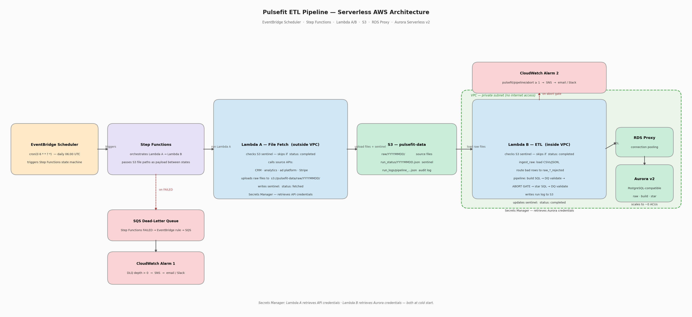

# Architecture

## Local data flow

```text
data/{users,events,ad_spend}.csv + data/subscriptions.json
    → Python ingestion → raw_pulsefit (staging, upserts, rejected rows)
    → build SQL       → build_pulsefit (typed, normalized, validated)
    → star SQL        → star_pulsefit (dimensions and facts)
    → sql/queries/    → channel costs, funnel conversion, data quality findings
```

## Responsibilities

- `src/ingest_raw.py` creates/checks the raw schema, stages files, and merges
  records using source keys and content hashes. Invalid inputs go to rejected tables.
- `sql/build_pulsefit.sql` parses dates, normalizes channels/countries, converts
  spend to USD, and records data quality counts and rejection reasons.
- `src/pipeline.py` executes build SQL, checks quality and raw-to-build integrity,
  and gates star promotion on build acceptance checks. After star SQL it records
  star checks, build-to-star integrity, and count reconciliation.
- `sql/star_pulsefit.sql` creates user, date, and channel dimensions plus event
  and ad-spend facts. Subscription data remains in the build layer.
- `src/validators/`, `src/sql_executor.py`, and `src/output.py` provide validation,
  per-file SQL transactions, and local JSON run summaries in `outputs/`.

Raw ingestion preserves existing records and skips unchanged content. Build and
star tables are fully rebuilt each run; each SQL file commits independently.
A failure does not roll back the entire ingestion/build/star workflow.

## Optional AWS deployment concept



The existing diagram sketches EventBridge Scheduler → Step Functions → a file-fetch
Lambda → an ETL Lambda → Aurora PostgreSQL, with S3 for files/logs, Secrets Manager
for credentials, and CloudWatch/SQS for failure reporting. Database access can use
RDS Proxy inside a private VPC. This is a deployment direction, **not implemented
infrastructure**; the repository runs locally without AWS.

## Assumptions and non-goals

- Small batch exports and one pipeline run at a time; shared staging tables are
  not designed for concurrent writers.
- A dedicated, disposable PostgreSQL database with schema/table creation rights.
- Static FX rates and source-specific date/channel rules illustrate the approach,
  not a general-purpose normalization engine.
- No streaming, scheduler, cloud provisioning, or production monitoring is included.
